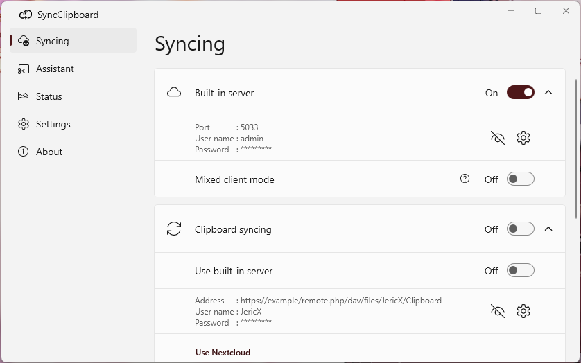

# SyncClipboard

[中文](README.md) | English

<details>
<summary>Contents</summary>

- [SyncClipboard](#syncclipboard)
  - [Features](#features)
  - [Breaking Changes](#breaking-changes)
    - [v3.1.1](#v311)
  - [Client](#client)
    - [Windows](#windows)
      - [Installer](#installer)
      - [Portable Version](#portable-version)
      - [WinGet](#winget)
      - [Troubleshooting](#troubleshooting)
    - [macOS](#macos)
      - [Manual Installation](#manual-installation)
      - [Homebrew](#homebrew)
      - [Troubleshooting](#troubleshooting-1)
    - [Linux](#linux)
      - [Manual Installation](#manual-installation-1)
      - [Arch Linux](#arch-linux)
      - [Troubleshooting](#troubleshooting-2)
    - [Desktop Client Command Line Arguments](#desktop-client-command-line-arguments)
      - [--shutdown-previous](#--shutdown-previous)
      - [--command-{command-name}](#--command-command-name)
    - [IOS](#ios)
      - [Use Shortcuts](#use-shortcuts)
    - [Android](#android)
      - [Use SyncClipboard Mobile](#use-syncclipboard-mobile)
    - [HarmonyOS Next](#harmonyos-next)
      - [Use ClipLink](#use-cliplink)
    - [Notes for Clients](#notes-for-clients)
  - [Server](#server)
    - [Standalone Server](#standalone-server)
      - [Server Configuration](#server-configuration)
      - [Docker](#docker)
      - [Arch Linux](#arch-linux-1)
    - [Desktop Client Built-in Server](#desktop-client-built-in-server)
    - [WebDAV Server](#webdav-server)
    - [S3 Server](#s3-server)
  - [API](#api)
    - [Get Clipboard](#get-clipboard)
    - [Upload Clipboard](#upload-clipboard)
    - [SyncClipboard.json](#syncclipboardjson)
    - [S3 Sync Protocol Specification](#s3-sync-protocol-specification)
  - [Open Source Dependencies](#open-source-dependencies)
  - [Donate](#donate)

</details>

## Features

- Cross-platform (Windows/macOS/Linux/mobile) real-time clipboard syncing, clipboard history management, and history syncing.
- Supports desktop client built-in server, Docker-deployed server, or storage services compatible with WebDAV/S3 APIs.
- Community-developed clients and tools built on the SyncClipboard API.
- Optimize image type clipboard:
  - Paste image to a textbox directly after copying a image file from file system, and vice versa.
  - Download the original file and copy it after copying a image in web browser. This is helpful for copying an animated image in browser. Web sites always prevent downloads from non-browser, so this feature isn't always usable.
  - Copy the transcoded temporary image file (jpg or gif) after copying a modern image file type (heic, webp, etc.).


> [!WARNING]  
> The clipboard history feature is in its early stages. Please be prepared for the possibility of losing all information. Do not rely solely on this tool to save important information.
>

## Breaking Changes
### [v3.1.1](https://github.com/Jeric-X/SyncClipboard/issues/286)
Clients and servers v3.1.1 and above are incompatible with previous versions. All clients, servers, and third-party clients in the sync network need to be upgraded together.

## Client

Clipboard is auto-synced between desktop clients running on Windows/Linux/macOS.

<details>
<summary>Screenshots</summary>



</details>

### Windows
#### Installer

Download the exe installer starting with `SyncClipboard_win_` from the [Release](https://github.com/Jeric-X/SyncClipboard/releases/latest) page. Double-click to run the installer and it will be ready to use.

#### Portable Version

Download the zip file starting with `SyncClipboard_win_` from the [Release](https://github.com/Jeric-X/SyncClipboard/releases/latest) page. Extract it and run `SyncClipboard.exe`.

#### WinGet

```powershell
winget install --id JericX.SyncClipboard --exact --source winget
```

#### Troubleshooting
- The minimum supported OS version is Windows 10 2004.
- If the interface icons are displayed incorrectly on Windows 10, download and install the Microsoft [Segoe Fluent Icons](https://aka.ms/SegoeFluentIcons) font.

### macOS

#### Manual Installation
Download the installation package starting with `SyncClipboard_macos_` from the [Release](https://github.com/Jeric-X/SyncClipboard/releases/latest) page. Double-click it and drag the SyncClipboard icon to the Applications folder.

#### Homebrew

```shell
brew install --cask Jeric-X/tap/syncclipboard
```

#### Troubleshooting
- System requirements: macOS 12.7 or later for Apple Silicon (arm64), and macOS 13.3 or later for Intel (x64).
- System prompts `“SyncClipboard” cannot be opened because the developer cannot be verified`: Go to `Settings` -> `Privacy & Security` on macOS, and click `Open Anyway`.
- System prompts `"SyncClipboard" is damaged, can't be opened`: Run the following command in the terminal: `sudo xattr -d com.apple.quarantine /Applications/SyncClipboard.app`
- Some features require Accessibility permissions. SyncClipboard will prompt for authorization when needed. If permission has been granted in System Settings but SyncClipboard still reports it as missing, remove SyncClipboard from the Accessibility permissions list, then restart SyncClipboard to request permission again.

### Linux
#### Manual Installation
Download the installation package starting with `SyncClipboard_linux_` from the [Release](https://github.com/Jeric-X/SyncClipboard/releases/latest) page.

#### Arch Linux

Arch Linux users can directly install from [AUR](https://aur.archlinux.org/packages/syncclipboard-desktop) (maintained by [@devome](https://github.com/devome)):

```shell
paru -Sy syncclipboard-desktop
```

After installation, you can launch it from the menu. If launching via the command `syncclipboard-desktop` results in an error, set the environment variable `LANG` to `en_US.UTF-8` or just start it using `LANG=en_US.UTF-8 syncclipboard-desktop`.

#### Troubleshooting

- Packages other than `AppImage` require **glibc 2.38 or later**. Run `ldd --version` to check your installed version.
- Clipboard sync is delayed, fails, or uploads garbled text: It is recommended to install `xclip` (for X11) or `wl-clipboard` (for Wayland) on your system. SyncClipboard will use these tools to help access the clipboard and improve stability. Use the commands `xclip -version` or `wl-paste -version` to check if they are installed.
- When upgrading using `deb` or `rpm` installation packages, if the upgrade fails, please uninstall the old version before installing the new one.
- When using the `AppImage` package, please ensure that the AppImage file has executable permissions.
- If hotkeys or copy/paste operations indirectly triggered through SyncClipboard fail on Wayland, check [input device permissions](docs/Linux-Input-Permissions_EN.md) first.
- The language cannot be auto-detected and defaults to English. You can change the language in SyncClipboard's settings after launching.

> [!NOTE]  
> To completely remove SyncClipboard, manually delete the configuration and temporary file directories:  
> `%AppData%\SyncClipboard\` (Windows), `~/Library/Application Support/SyncClipboard/` (macOS), `~/.config/SyncClipboard/` (Linux)

### Desktop Client Command Line Arguments

#### --shutdown-previous
Closes any running instance of SyncClipboard and starts a new one.

#### --command-{command-name}
Executes the specified command, where `{command-name}` is the name of the command. After setting a shortcut key, you can view the corresponding command name in the configuration file. Even if the shortcut key configuration is cleared, the command line argument remains valid.  
If a SyncClipboard instance is already running, it will not start a new instance but will instruct the running SyncClipboard to execute the command. If no instance is running, the command will be executed immediately after startup.  
Multiple `--command-{command-name}` arguments are supported, multiple commands are executed simultaneously.  

> [!NOTE]  
> When using command line arguments on macOS, please use the full path to the executable: `/Applications/SyncClipboard.app/Contents/MacOS/SyncClipboard.Desktop.MacOS`

### IOS 
#### Use [Shortcuts](https://apps.apple.com/us/app/shortcuts/id1462947752)  

> [!WARNING]
> When importing the shortcut, you may be unable to edit the server information ([#306](https://github.com/Jeric-X/SyncClipboard/issues/306)). You can import it without changing the server information first, then edit the server information in the shortcut afterward.
>

- Sync manually, import this [Shortcut](https://www.icloud.com/shortcuts/321944d62831416f9d2ba7917917686a)
- Sync Automatically, import this [Shortcut](https://www.icloud.com/shortcuts/05e7ac5aca5f4f588b776117cf740587). This shortcut keeps running in the background forever, you need to stop it manually. You can also change whether to send notifications and querying interval time manullay.

### Android
#### Use [SyncClipboard Mobile](https://github.com/Jeric-X/syncclipboard-mobile)

- Quick manual trigger from notification center, home screen shortcut, and share menu
- Limited background sync capability
- Clipboard history and history sync
- Auto-upload SMS verification codes

### HarmonyOS Next
#### Use [ClipLink](https://github.com/xiebaiyuan/ClipLink)

A HarmonyOS Next client. Download the `.hap` file from [Releases](https://github.com/xiebaiyuan/ClipLink/releases) and install via [auto-installer](https://github.com/likuai2010/auto-installer) or `hdc install` (sideloading required due to HarmonyOS restrictions).

### Notes for Clients

There are three necessery config(maybe different words, same uses).
- username
- password
- url, format is `http://ip(or domain name):port`. When using a WebDav server, url needs to be pointed to a specific existing folder as the working folder, like `https://domain.com/dav/folder1/working%20folder`. File name is the best not to contain any special characters or spaces, or you'll have to URL encode it. And do not use this folder to do anything else. If not using a desktop client(Windows/Linux/macOS), create a folder named `file` in the working folder to sync files. Desktop clients create this folder automatically. Make sure no slash(/) at the end of url.

## Server
### Standalone Server
[SyncClipboard.Server](https://github.com/Jeric-X/SyncClipboard/releases/) is cross-platform, depends on [ASP.NET Core 10.0](https://dotnet.microsoft.com/en-us/download/dotnet/10.0). Run with:
```
dotnet /path/to/SyncClipboard.Server.dll --contentRoot ./
```
Content root folder is `SyncClipboard.Server.dll`'s parent folder. Writing permission is needed. Choosing a different content root folder is possible. Copy a new `appsettings.json` to the folder and run with:
```
dotnet /path/to/SyncClipboard.Server.dll --contentRoot /path/to/contentRoot
```

#### Server Configuration
`appsettings.json` is the config file.
```jsonc
{
  "Logging": {
    "LogLevel": {
      "Default": "Information",
      "Microsoft.AspNetCore": "Warning"
    }
  },
  "AllowedHosts": "*",
  "Kestrel": {
    "Endpoints": {
      "http": {
        "Url": "http://*:5033"
      },
      //"https": {
      //  "Url": "https://*:5033"
      //}
    },
    //"Certificates": {
    //  "Default": {
    //    "Path": "/path/to/pem",
    //    "KeyPath": "/path/to/pem_key"
    //  }
    //}
  },
  "AppSettings": {
    "UserName": "your_username",
    "Password": "your_password",
    "MaxSavedHistoryCount": 1000, // Maximum history count; 0 means no count limit. The retention time limit still applies.
    "ProtectTaggedRecords": true, // Protect tagged records from automatic cleanup; starred and pinned records stay protected.
    "HistoryRetentionMinutes": 0 // Retention in minutes; 0 means no time limit. The history count limit still applies.
  }
}
```
For more information, please refer to the [official Microsoft documentation](https://learn.microsoft.com/en-us/aspnet/core/fundamentals/servers/kestrel/endpoints?view=aspnetcore-10.0#configure-https-in-appsettingsjson).

Username and password can be set by environment variables. When the environment variables `SYNCCLIPBOARD_USERNAME` and `SYNCCLIPBOARD_PASSWORD` are both set, they will be used as the username and password.  

`ASPNETCORE_hostBuilder__reloadConfigOnChange` is used to configure whether to automatically detect changes in `appsettings.json` and reload the configuration. The default value is false. Changing it to any value other than false will enable this feature.

> [!WARNING]  
> HTTP transmits data in plaintext. When deploying the server on a public network, please enable HTTPS or configure HTTPS using a reverse proxy tool. If obtaining a certificate from a certificate authority is not possible, it is recommended to use the open-source tool [mkcert](https://github.com/FiloSottile/mkcert) or other methods to generate a self-signed certificate.

#### Docker

```shell
# docker
docker run -d \
  --name=syncclipboard-server \
  -p 5033:5033 \
  -e SYNCCLIPBOARD_USERNAME=your_username \
  -e SYNCCLIPBOARD_PASSWORD=your_password \
  -v /data/syncclipboard-server:/app/data \
  --restart unless-stopped \
  jericx/syncclipboard-server:latest

# docker compose
curl -sL https://github.com/Jeric-X/SyncClipboard/raw/master/src/SyncClipboard.Server/docker-compose.yml >> docker-compose.yml
docker compose up -d
```

After the container starts for the first time, a default `appsettings.json` will be automatically created in the container directory `/app/data` (which corresponds to the host directory `/data/syncclipboard-server`).  
When modifying `appsettings.json`, pay attention to the file path mapping between the container and the host.

#### Arch Linux

You can install it directly from [AUR](https://aur.archlinux.org/packages/syncclipboard-server) (maintained by [@devome](https://github.com/devome)):

```shell
paru -Sy syncclipboard-server
```

The configuration file path is `/etc/syncclipboard/appsettings.json`. After modifying the configuration, you can start the service using `systemctl` command:

```shell
sudo systemctl enable --now syncclipboard.service
```

### Desktop Client Built-in Server
Desktop client (Windows/Linux/macOS) has a built-in server, can be configured with GUI.

### WebDAV Server
  
Tested server：   
- [x] [Nextcloud](https://nextcloud.com/)
- [x] [AList](https://alist.nn.ci/)
- [x] [InfiniCLOUD](https://infini-cloud.net/en/)
- [x] [aliyundrive-webdav](https://github.com/messense/aliyundrive-webdav)

### S3 Server
The desktop client supports AWS S3 via the official AWS SDK, and also supports OSS providers that expose an S3-compatible API.  
When adding an account, choose `S3` and configure:

- `Server Address`: Optional. Leave empty for AWS; set your endpoint for S3-compatible providers.
- `Region`: Signing region, for example `us-east-1`.
- `Bucket Name`: Bucket used to store `SyncClipboard.json` and `file/` objects.
- `Object Prefix`: Optional. Recommended to isolate data with a dedicated prefix (for example `syncclipboard`).
- `Force Path-Style Addressing`: Recommended for many S3-compatible providers.
- `Access Key ID` / `Secret Access Key`: Access credentials.

## API

In a standalone server environment, set the environment variable ASPNETCORE_ENVIRONMENT to Development before running the server, or open the server in the desktop client and enable diagnostic mode in settings.
Then visit `http://ip:port/swagger/index.html` to access the API description page.

APIs that do not start with `/api/` are WebDAV-compatible APIs. When implementing clients, calling these APIs can support clipboard synchronization based on both WebDAV servers and official SyncClipboard servers. The key APIs are described below.

### Get Clipboard
```shell
GET /SyncClipboard.json
GET /file/dataName            # optional
```

### Upload Clipboard
```shell
PUT /file/dataName            # optional
PUT /SyncClipboard.json
```

### SyncClipboard.json
```jsonc
{
  "type": "Text",                          // or Image/File/Group, required
  "hash": "string",                        // optional, empty string is treated as null
  "text": "string",                        // required
  "hasData": true,                         // or false, required
  "dataName": "string",                    // if hasData is true, required
  "transferDataHash": "string",            // optional
  "size": 0,                               // optional
  "syncedAt": "2026-10-09T15:30:00+08:00"  // optional
}
```

- All API fields are case-sensitive
- `text` stores the clipboard preview string, or the complete content of Text type clipboard
- `hasData` indicates whether an additional file is used to store the complete clipboard information
  - For Image/File/Group types, `hasData` is always true
  - For Text type, depending on the original string length, you can optionally use an additional UTF8-encoded `.txt` file to store the complete string. If so, the `text` field only stores the beginning part of the complete string
- `hash` value is a unique identifier of the clipboard content. For the calculation method, please refer to [docs/Hash.md](docs/Hash.md)
  - The sender should provide `hash` information whenever possible
  - When the `hash` value exists, the receiver should verify the consistency between the `hash` information and the clipboard content, and execute the error handling process when inconsistent
  - When `hash` is empty, or in an environment where `hash` cannot be calculated, you can use the combination of `type`/`text` to simply determine the equality of clipboard content
- `transferDataHash` is the SHA-256 of the complete byte stream of the actual transfer file, encoded as 64 uppercase hexadecimal characters, and is used to verify transfer file integrity
  - Use it only when `hasData` is `true`
- `size` indicates the total byte size of the copied file, or the length of the complete string for Text type clipboard
- `syncedAt` records when the current remote clipboard was submitted, as an ISO 8601 timestamp with a UTC offset
  - When the official server receives a clipboard upload, it uses the server's time and ignores the time provided by the client
  - For WebDAV/S3, the client sets this field when uploading
  - Client clocks may differ, so this field should not be used to determine concurrent write ordering

### S3 Sync Protocol Specification

For protocol and data format specifications when using S3-compatible object storage as sync backend, please refer to [S3 Adapter Design](docs/S3-Adapter-Design.md).

### History API

The official standalone server and the desktop client's built-in server share these endpoints, authenticated with HTTP Basic authentication. WebDAV and S3 do not provide them. Replace `USER`, `PASSWORD`, the server URL and content hash in the examples with actual values; see [Hash.md](docs/Hash.md) for hash calculation.

#### Capability negotiation

`GET /api/capabilities`:

```json
{"historySync":true,"historyTags":true,"historyName":true}
```

`historySync` indicates basic history synchronization. `historyTags` and `historyName` independently indicate tag and name synchronization support. Clients should check each field and synchronize that metadata only when supported; a missing or `false` field does not declare support. Older servers may return 404 for the capability endpoint. Do not infer name support from a version or tag support. Probe again after changing connections or accounts. Names and tags are history metadata; they do not change the record type, content hash or pasted content.

#### Name and tag states

JSON uses `name` and `tags`. Multipart text parts use the same names; the server also accepts the older client's `Tags` spelling.

| Field | Missing or JSON `null` | Explicit clear | Set value |
| --- | --- | --- | --- |
| `name` | Unknown for a new record; preserve the existing value when merging | `""` | `"App icon"` |
| `tags` | Unknown for a new record; preserve the existing value when merging | `[]` | `["Work","工作"]` |

Each field is merged independently. Names are trimmed on write; whitespace-only input clears the name. Tags are NFC-normalized, trimmed, deduplicated and sorted with case-sensitive comparisons. Each tag must contain 1–64 Unicode characters without control characters or line breaks; a record can have at most 32 distinct tags.

Writes follow the existing record version and modification-time conflict rules; explicit clearing does not bypass conflict resolution. Older requests that omit fields do not clear existing values. A stale request may only backfill nonempty metadata into fields that remain unknown on the server; it cannot overwrite known or explicitly cleared values.

#### Initial or duplicate upload

`POST /api/history` accepts `multipart/form-data`. All metadata must precede the optional binary `data` part. `hash` and `type` are required. Use `Text`, `Image`, `File` or `Group` for `type`. Other optional metadata includes `text`, `size`, `createTime`, `lastModified`, `lastAccessed`, `version`, `starred`, `pinned`, `isDeleted` and `hasData`.

`name` is plain text, not a JSON string: an empty text part clears it, omission means unknown, and the literal text `null` is a valid four-character name. `tags` is a text part containing a JSON array: `[]` clears it, omission or the text `null` means unknown, and empty text is invalid JSON.

```sh
curl -u 'USER:PASSWORD' 'http://localhost:5033/api/history' \
  --form-string 'hash=CONTENT_HASH' \
  --form-string 'type=Image' \
  --form-string 'text=icon.png' \
  --form-string 'name=App icon' \
  --form-string 'tags=["Work","工作"]' \
  --form-string 'hasData=true' \
  -F 'data=@icon.png'
```

Use `--form-string 'name='` to clear the name and `--form-string 'tags=[]'` to clear tags. When sending `data`, the optional `X-SyncClipboard-Transfer-Data-Hash` request header can declare the actual transfer file's SHA-256 as 64 uppercase hexadecimal characters. Transfer data follows the existing format for its profile type.

Success returns **200** with the final `HistoryRecordDto`. Duplicate uploads also return the final server record; do not assume the response equals the request. Invalid metadata returns 400, and transfer-data validation failures return 422.

#### Update metadata

`PATCH /api/history/{type}/{hash}` accepts JSON. Name, tags, starred status, pinned status, deletion status, version and timestamps are optional. To set a name and tags:

```sh
curl -u 'USER:PASSWORD' -X PATCH \
  'http://localhost:5033/api/history/Image/CONTENT_HASH' \
  -H 'Content-Type: application/json' \
  -d '{"name":"App icon","tags":["Work","工作"]}'
```

Clear both fields:

```json
{"name":"","tags":[]}
```

Change only starred status, preserving name and tags:

```json
{"starred":true}
```

Synchronization clients can include `version`, `lastModified` and `lastAccessed` (ISO 8601 with a time zone). When version and modification time are omitted, the server supplies them under the existing rules. **200** indicates an accepted update and **409** a conflict; both return the final server metadata, which clients should merge with concurrency checks. A missing record or a record that cannot be restored returns 404.

Example PATCH response (200 and 409 share this structure; values reflect the final server record):

```json
{
  "name": "App icon",
  "tags": ["Work", "工作"],
  "starred": true,
  "pinned": false,
  "isDelete": false,
  "version": 2,
  "lastModified": "2026-11-18T00:00:00Z",
  "lastAccessed": "2026-11-18T00:00:00Z"
}
```

Unknown `name` and `tags` are omitted from PATCH responses; explicitly cleared values appear as `""` and `[]`. Preserve this distinction when merging, and prevent late responses from overwriting subsequent local edits. PATCH uses `isDelete`, while full history records use `isDeleted`.

#### Queries and real-time notifications

- `GET /api/history/{profileId}` returns one full record. `profileId` is `Type-Hash`, such as `Image-CONTENT_HASH`; a missing record returns 404.
- `POST /api/history/query` accepts form fields and returns an array of full records. `page` starts at 1, with at most 50 records per page.
- `GET /api/history/{profileId}/data` downloads the transfer data. The `X-SyncClipboard-Transfer-Data-Hash` response header provides its checksum.
- SignalR `/SyncClipboardHub` sends `RemoteHistoryChanged` with the same full-record structure.

By default, `searchText` matches only the original content. When the server supports `historyName`, send `searchNames=true` to also match record names. The `tags` filter is a JSON-array text part and matches any complete tag name. `onlyUntagged=true` cannot be combined with a nonempty tag filter. You can also combine `types` (type flags), `starred`, `before`, `after`, `modifiedAfter` and `sortByLastAccessed`; filtering happens before pagination.

```sh
curl -u 'USER:PASSWORD' 'http://localhost:5033/api/history/query' \
  --form-string 'page=1' \
  --form-string 'searchText=icon' \
  --form-string 'searchNames=true' \
  --form-string 'tags=["Work"]'
```

Example full record used by creation responses, single-record queries and real-time notifications; paginated queries return an array of these objects:

```json
{
  "name": "App icon",
  "tags": ["Work", "工作"],
  "hash": "CONTENT_HASH",
  "text": "icon.png",
  "type": "Image",
  "createTime": "2026-11-18T00:00:00Z",
  "lastModified": "2026-11-18T00:00:00Z",
  "lastAccessed": "2026-11-18T00:00:00Z",
  "starred": true,
  "pinned": false,
  "size": 1024,
  "hasData": true,
  "version": 2,
  "isDeleted": false
}
```

Full records return `null` for unknown metadata, and `""` or `[]` for explicit clears. Older servers may omit these fields; clients should not clear local values merely because fields are absent. Incremental queries use `modifiedAfter`. A record missing from search results is not evidence of server deletion; confirm it with a full reconciliation without a search keyword.

## Open Source Dependencies
[NativeNotification](https://github.com/Jeric-X/NativeNotification) 
[Magick.NET](https://github.com/dlemstra/Magick.NET)  
[.NET Community Toolkit](https://github.com/CommunityToolkit/dotnet)  
[H.NotifyIcon](https://github.com/HavenDV/H.NotifyIcon)  
[WinUIEx](https://github.com/dotMorten/WinUIEx)  
[moq](https://github.com/moq/moq)  
[Avalonia](https://avaloniaui.net/)  
[FluentAvalonia](https://github.com/amwx/FluentAvalonia)  
[AsyncImageLoader.Avalonia](https://github.com/AvaloniaUtils/AsyncImageLoader.Avalonia)  
[Vanara](https://github.com/dahall/Vanara)  
[Tmds.DBus](https://github.com/tmds/Tmds.DBus)  
[SharpHook](https://github.com/TolikPylypchuk/SharpHook)  
[Quartz.NET](https://github.com/quartznet/quartznet)   

## Donate

If SyncClipboard helps you, donations are welcome to support ongoing maintenance. View donation details [here](docs/donate.md).
